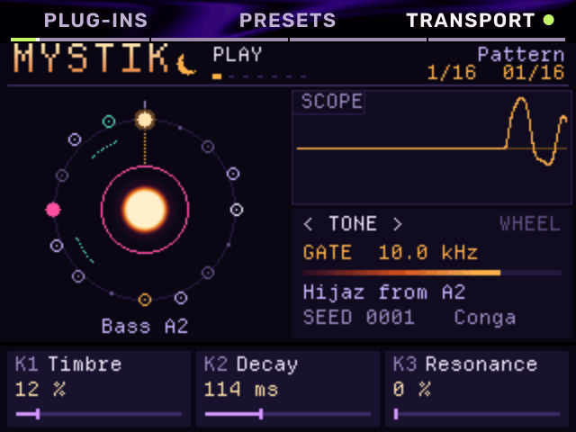
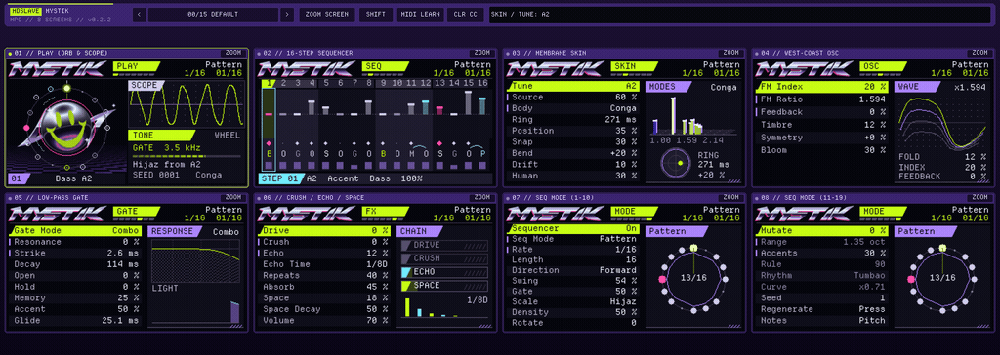
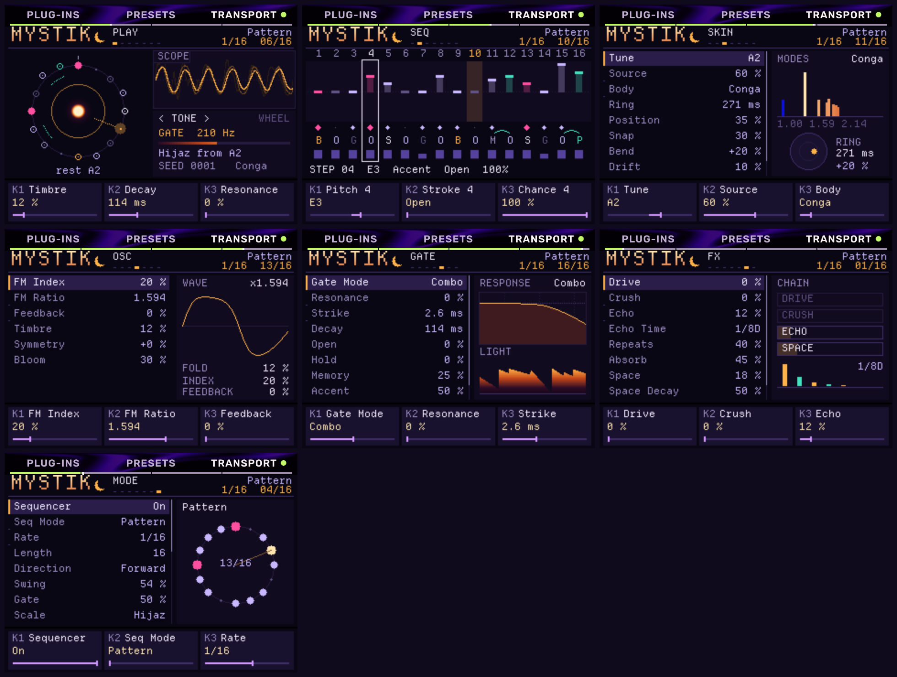

# hdslave Mystik

**A west-coast physical hand drum, Buchla-style vactrol low-pass gate, and 6-mode sequencer as a CLAP plug-in for the Akai MPC Sample.**

<table>
  <tr>
    <th width="34%">MPC Sample</th>
    <th width="66%">macOS and Windows · CLAP</th>
  </tr>
  <tr>
    <td align="center"></td>
    <td align="center"></td>
  </tr>
</table>

> **Desktop CLAP version (macOS & Windows):** A separate desktop CLAP build with all MPC screens on one interactive panel lives in [**`mac-clap/`**](mac-clap/) (`cd mac-clap && ./install-macos.sh`). Releases in this repo stay MPC Sample-only for now while the desktop builds are being finalized.

Built for the Akai MPC Sample running [Melodee](https://github.com/keremimo/melodee-sample) / [hdslaveOS](https://github.com/hdslave/hdslaveOS) (64-bit ARM Linux, Cortex-A55). Mystik pairs an 8-mode physical membrane (nine bodies from tabla to iron bell) and a wavefolding complex oscillator — struck by eight hand strokes through a modelled 292 vactrol low-pass gate — with a six-mode sequencer, four lo-fi effects, and seven acid-rave custom pages under **hdslaveOS** (other hosts show the standard parameter list).

- **The gate** is the 292-style low-pass gate of Parker and D'Angelo's model: the vactrol's LDR curve, a light that
  rises in about 12 ms and falls in about 250 ms (slower as it darkens), the circuit's own transfer function for VCA,
  Combo and Lowpass and everything between, its resonance. A strike lights it; brightness and loudness fall together,
  as a struck object's do.
- **The drum** is a membrane (eight modes as rotations, so bends and slides stay clean) of nine bodies (tabla, conga,
  frame drum, udu, slit log drum, handpan, singing bowl, iron bell, goblet) struck by a hand: a contact that is shorter
  and brighter the harder it lands, a noise burst whose crack has its own band (a slap pops), a palm that damps what
  still rings, eight strokes (open, slap, bass, mute, ghost, flam, roll, press), a pitch bend that falls as the head's
  swing does (a talking drum's), no two hits quite alike (Human), all mixed with a complex oscillator (phase
  modulation by a second sine, feedback from the gate, a wavefolder) that the gate's light can open further (Bloom).
- **The sequencer** can be off; on, it plays 16 steps (pitch as a scale degree, trig, stroke, chance) as Pattern,
  Euclid, Turing, Automaton, Bounce or Rhythm (14 traditional timelines from tresillo to teental), with slides,
  303-style accents that build on each other, swing, density, rotation, mutation, twelve scales (Pelog and Slendro
  microtonal), a seed and Regenerate. While it is on, pads 1-16 play its steps in every bank, so a pattern can be heard step by step.
- **The effects**: Drive, Crush, a ping-pong Echo synced to the tempo with Absorb in its loop, Space (a spring-like
  tank of dispersive allpasses).
- **Cost**: about 91,000 instructions a 128-frame block playing (1.9 % of one of the MPC's cores), 2,000 stopped;
  a page frame about 380,000 instructions in the PLAY benchmark, redrawing only what moved.

Version 0.4.0. Not yet run on the MPC itself: tested in Melodee's own CLAP host and screen tool (see Testing); the
pads' drum map and banks (0.4) have not been tried on the device either.

## Install

Copy `Mystik.clap` (built as below, or from the card's staging) to the card as
`Melodee/Plugins/hdslave/hdslave Mystik.clap`, with this README and `LICENSE-OFL-departure-mono.txt`.
Load it on a plug-in track. The custom screen uses `melodee.screen/1` on Melodee 0.7 and hdslaveOS based on it. Open Edit on the plug-in track or select PANEL on Stage.

## Playing it

Minus and Plus turn the pages; Shift shows what the controls do on the page in view.

| Page | Picture | Wheel | Push | K1 / K2 / K3 |
|---|---|---|---|---|
| PLAY | a chrome smiley whose green enamel follows the vactrol’s light, the ring of steps (accents, slides, the step playing), a phosphor scope, the gate's cutoff now | picks a trio for the pots: TONE, HIT, SKIN, WEIRD, GROOVE, SPACE | Sequencer on/off; Shift + Push: Regenerate | the trio (TONE: Timbre, Decay, Resonance) |
| SEQ | 16 lanes: pitch, trig, stroke letter, chance; the step playing lit | picks a step | cycles its trig (Rest, Hit, Accent, Slide, Acc+Slide); Shift + Push plays it | its Pitch, Stroke, Chance |
| SKIN | the body's modes as struck at Position, the drum head | moves the cursor (Push to edit: the wheel then sets the value, Shift + wheel finely, Minus/Plus coarsely) | edit / done | the cursor's row and the next two |
| OSC | one cycle of the oscillator as folded, at the gate's present light | as SKIN | | |
| GATE | the gate's response now (20 Hz to 20 kHz) and the light's last 1.4 s | as SKIN | | |
| FX | the chain, the echo's taps | as SKIN | | |
| MODE | the mode at work: the Euclid ring, the Turing register, the automaton's last 16 generations, the bounces, the timeline's strokes | as SKIN (rows a mode does not use are dimmed) | | |

Pads and keys. Mystik names its pads for hdslaveOS (a drum map in the plug-in), so a plug-in track plays them as
Drums: **pads A01-A16 are keys 36-51 whatever the track's octave, key or scale**, the Keys page names them Step 1 to
Step 16, and Minus / Plus on Stage move the **bank** (B 52-67, C 68-83, D 84-99) instead of the octave. Where the
pads are steps (the Sequencer on, or Notes: Steps), every bank plays the same 16 steps an octave higher than the bank
below: a key is pad (key - 36) mod 16 of bank (key - 36) / 16 (rounded down), and the bank counts -2 to +3 (A to D are
0 to 3 octaves up; keys under 36 are banks -1 and -2, keys over 99 play as D). So the step pads never shift to other
steps, transpose by surprise or fall silent after a bank change. Where a key plays a pitch or a stroke (Notes: Pitch
and Strokes, with the Sequencer off), it plays exactly what it played before 0.4.
**Sequencer on: pads 1-16 play steps 1-16**, whether the song plays or not, in every bank, an octave up a bank (bank B's
pad 1 is step 1 an octave up). A pad plays its step once, as the sequence plays it: its pitch in the scale, its
stroke, its accent (a hit at velocity 100 or more accents too). It plays a step that rests, or that Chance or Density
would drop, too. It does not move the sequence: the step the sequence plays next is the one it would have played
anyway, and it takes the drum back. In Euclid, Turing, Automaton, Bounce and Rhythm a pad plays the step's own Pitch,
Trig and Stroke (so not Turing's pitches, the accents Euclid and Automaton add, or a timeline's strokes). Two pads at
once: the louder plays. A pad struck just as the sequence plays a step gives way to that step. While a pad is held,
Hold keeps the gate lit, until the pad is let go or the sequence's next step takes over. (What 0.4 replaced: with the
Sequencer on, keys outside 36-51 transposed the pattern while the song played, and played the drum as Notes says while
it was stopped; every key is a step pad now, and nothing transposes the pattern. Notes: Steps played step
(key - 36) mod 16 at the same pitch in every octave; it now plays a bank an octave up.) A key that struck the drum (with the Sequencer off) keeps
Hold lit while it is held, through Play, Stop or the Sequencer switched off, until it is let go or a step of the
sequence, SEQ's Shift + Push, or a newer key or pad takes the drum. Hold
follows the key or pad that struck the drum last: an older one still held, let go before or after, ends nothing (in
Pitch the newer of two keys let go glides back to the older, which then plays the drum). Shift + Push's step keeps
its gate for Gate's share of an eighth of a second, whether a key is held or not, and through a Stop, unless a step
of the sequence takes the drum first (an older step's gate end no longer ends it; the step drops the audition's flam
or roll hits still to come, as it drops a pad's). A key let go meanwhile does not slide back to another one held; nor
does one let go once a step has taken the drum, nor onto a drum gone quiet (it would strike it anew). A step that
plays takes the drum from every older strike, so no older gate end still to come cuts its Hold: an older ball's in a
loop shorter than Bounce's cycle (each time round drops a new ball), a step's whose gate runs past a loop's wrap, or
one a Rate change or a tempo change left running. A gate end always comes: when the queue of hits still to come is
full (a burst of rolls, or such a loop in Bounce), a hit gives way to it.
**Sequencer off: the pads play
notes**, as Notes says: **Pitch** (the key sets the pitch from C3, so bank B's pad 1, key 52, is 16 semitones over
pad 1; velocity 100 or more accents; overlapping keys slide and hold), **Strokes** (keys 36-43 play the eight strokes
at Tune, each 8 keys up an octave: two drums, high and low, like a pair of bongos), **Steps** (pads 1-16 play steps
1-16, an octave up a bank, as the step pads do with the Sequencer on).
Pitch bend is +-2 semitones, the mod wheel folds.
Melodee's All Sound Off (CC 120 at 0) silences the drum and the tails, All Notes Off (CC 123 at 0) lets held notes go,
Reset All Controllers (CC 121) puts the bend and the mod wheel back at rest, a choke stops the drum.

## Parameters

Ids are fixed forever (a project keeps values by id); see `docs/design.md` for the table of ids.

**Skin**

| Name | Range | What it does |
|---|---|---|
| Tune | C-1 to C5 (default A2) | the drum's pitch; the sequencer's scale counts from it |
| Source | 0-100 % | the oscillator (0) to the membrane (100) |
| Body | Tabla, Conga, Frame, Udu, Slit, Handpan, Bowl, Bell, Goblet | the membrane's modes: ratios, how the strike's place weighs them, their decays (Conga and Goblet have their shell's air under the head: a palm at the centre booms) |
| Ring | 30 ms - 4 s | the membrane's fundamental falls 60 dB in this (higher modes sooner, by the body) |
| Position | centre to edge | where the hand lands: the centre rings the round modes, the edge the rest |
| Snap | 0-100 % | the hand's noise: through the skin and straight into the gate (a slap's crack) |
| Bend | -100 to +100 % | the hit raises the pitch, which falls back (negative: rises after, an udu's bloop); harder hits more |
| Drift | 0-100 % | a slow random wander of the pitch (up to 0.6 semitone) |
| Human | 0-100 % | no two hits alike: at 100 % each hit's force +-8 %, place +-0.08, contact +-20 %, bend +-25 % and each mode's tuning +-0.4 % (the same for the same hit) |

**Osc**

| Name | Range | What it does |
|---|---|---|
| FM Index | 0-100 % | phase modulation of the principal by the modulator (up to 8 radians) |
| FM Ratio | 1/2 ... 7, and 1.414, 1.594, 2.136, 2.296, 2.653, 2.918, 3.156 | the modulator's frequency; the last six are a membrane's own ratios (wooden, drum-like) |
| Feedback | 0-100 % | the gate's output back into the oscillator's phase: grit, then chaos |
| Timbre | 0-100 % | the wavefolder (a sine fold, up to 12 times) on oscillator and membrane alike |
| Symmetry | -100 to +100 % | the fold's bias: even harmonics |
| Bloom | 0-100 % | the gate's light opens the fold and the FM further: a strike brightens as it opens |

**Gate**

| Name | Range | What it does |
|---|---|---|
| Gate Mode | VCA ... Combo ... Lowpass | the 292's modes, morphed: VCA (loudness, little filtering), Combo (both, the classic), Lowpass (a resonant 2-pole) |
| Resonance | 0-100 % | the Lowpass mode's feedback (and its capacitor brought in): a bump at 0, ringing like a pinged filter near 100 |
| Strike | 0.5 - 30 ms | how long the LED is lit by a hit: longer opens the gate further and longer |
| Decay | 25 ms - 2.5 s | the vactrol's fall (the VTL5C3's 250 ms at 50 %) |
| Open | 0-100 % | a light that stays on: the gate never quite closes (a drone at 100 %) |
| Hold | 0-100 % | while a step's gate (or a key) is held the LED stays lit this much: sustained, 303-like notes |
| Memory | 0-100 % | a vactrol's light history: played often, it falls slower (up to 6 times) |
| Accent | 0-100 % | how much harder an accent strikes; consecutive accents build on a capacitor (300 ms) |
| Glide | 5 - 500 ms | a slide's time |

**FX**: Drive (soft clip, up to 18 dB), Crush (sample rate to 1.5 kHz and bits to 3, together), Echo (the wet level),
Echo Time (1/32 to 1/2, dotted and triplets, at the song's tempo), Repeats (to 105 %: it can run away, held by a soft
clip; a 20 Hz high-pass in the loop keeps DC from building up), Absorb (14 kHz to 600 Hz in the loop), Space (the
tank's level), Space Decay, Volume.

**Sequencer**

| Name | What it does |
|---|---|
| Sequencer | Off / On. On, pads 1-16 play its steps; off, they play notes (see Playing it) |
| Seq Mode | Pattern, Euclid, Turing, Automaton, Bounce, Rhythm (below) |
| Rate | 1/2 to 1/64, triplets: a step on each from the song's top, so the same place always plays the same step (a host's pre-roll before the top plays the steps leading into step 1, each with its gate) |
| Length | 1-16 steps (Rhythm uses its timeline's) |
| Direction | Forward, Backward, Ping-Pong, Brownian (a random walk, mostly forward), Random |
| Swing | 50-75 %: every second step late, as an MPC's swing |
| Gate | how long a step's gate is held (Hold uses it); a slide after holds it through (if that step then does not play, the gate ends at its time) |
| Scale | Chromatic, Major, Minor, Dorian, Phrygian, Hijaz, Bhairav, Pent Minor, Pent Major, Hirajoshi, Pelog, Slendro |
| Density | Pattern: under 50 % drops hits, over fills rests with ghost notes; Euclid: the pulses; Turing: how many register values play; Automaton: the first generation's cells; Bounce: the bounces |
| Rotate | where the cycle starts |
| Mutate | Pattern: some steps move a degree or two each pass; Euclid: hits flip; Turing: the chance the bit going round flips (0 locks the loop); Automaton: cells flip; Bounce: timing jitter; Rhythm: ghost notes in the rests |
| Range | Turing's pitch spread (0.25-3 octaves) |
| Accents | Euclid's accent ring, Turing's accents, the automaton's births, a timeline's bass strokes |
| Rule | the automaton's rule, 0-255 (90 draws Sierpinski's triangle, 30 is chaos, 110 complex) |
| Rhythm | Tresillo, Cinquillo, Son Clave, Rumba Clave, Bossa, Bell 12/8, Tumbao, Maqsum, Baladi, Saidi, Malfuf, Teental, Keherwa, Dadra, Rupak |
| Curve | Bounce: each bounce this much shorter (x0.50-0.92) |
| Seed | all the randomness (a hash of the step's place, the seed and a salt) |
| Regenerate | a new Seed (told to the host) |
| Notes | Pitch, Strokes, Steps: what the pads and keys play with the sequencer off (see Playing it) |

Per step: **Pitch** (a degree of Scale, -21 to 21), **Trig** (Rest, Hit, Accent, Slide, Acc+Slide: a slide glides
into the step without a new strike), **Stroke** (Open, Slap, Bass, Mute, Ghost, Flam, Roll, Press), **Chance**.

The song's place a little off its line, either way, by up to a 64th note, is followed as it is: hdslaveOS works
the place out from its ticks, so a swung tick, a tick on a block's edge or MTC's trim puts it up to 0.0021 of a
quarter off from block to block, and a plug-in two tracks play is run twice a block (its next block's first call told
a block back). A step back holds the steps already played until the song is past them again (a Rate change meanwhile
counts on from where the steps got to, so none plays again). Up to 0.3.5 a step back
of more than the call's own frames counted as a jump: with the calls in parts, at slow tempos or run twice a block, a
step could play twice or be lost (at 40 BPM with the place up to 0.002 of a quarter off, 22 of 96 sixteenths played
twice, 3 were lost). A move of more than a 64th note is a jump, as before (exactly a 64th, as hdslaveOS has it, is
not), and so is one on past two clocks (Swing 75 at 1/64): the step the song landed on plays, not the two passed on one
frame.

The modes:

- **Pattern**: the 16 steps as written, by Direction.
- **Euclid**: Density x Length pulses spread as evenly as can be (the Bjorklund rhythms Toussaint found in timelines
  the world over), each pulse playing its step; an accent ring among them.
- **Turing**: a shift register of Length bits; the bit going round flips by Mutate, and its bits make the pitch, the
  gate, accents and slides. Locked it loops; open it wanders.
- **Automaton**: an elementary cellular automaton on a ring of Length cells, a generation each pass, live cells
  playing their steps. The MODE page draws its history.
- **Bounce**: a ball dropped each cycle: its bounces quicken and soften, each playing the next step.
- **Rhythm**: a traditional timeline and its strokes (a doumbek's dum and tek, a tabla's dha and na, a conga's heel,
  toe, slap and open), its pitches from the steps.

## Presets

Mystik (a conga line in Hijaz), West Bongo (the oscillator alone, pinged), Tabla Teental, Conga Tumbao, Udu Bloom,
Acid Gate (a 303-ish line through the Lowpass mode), Turing Acid, Singing Bowl, Slit Euclid (Slendro), Handpan Drift,
Maqsum Night, Feedback Witch, Bouncing Ball, Gankogui Bell (the standard bell pattern): the presets of 0.1, ported to
the 0.2 engine with their values exactly as they were and Human at 0 (0.1 had no variation from hit to hit). And
Goblet Maqsum (0.2): the maqsum on the Goblet body, the doumbek's own.

## Sources, and what is inferred

- The gate: Julian Parker and Stefano D'Angelo, "A Digital Model of the Buchla Lowpass-Gate", DAFx-13 (Maynooth,
  2013): the LDR mapping `Rf = A / If^1.4 + B` (A = 3.464, B = 1136.212 ohm, If to 40 mA), the light's 12 ms rise and
  250 ms fall, faster when bright, the transfer function `1 / (a1 + a2 s + a3 s^2)` and its coefficients, the component
  values of the three modes, the resonance limit `amax`, the DC gain. Realised here as a trapezoidal state-variable
  filter (each real pole prewarped, so the response holds to the analog one; the tests check it to 0.35 dB).
- Membranes: the ideal circular membrane's Bessel-zero ratios (1, 1.594, 2.136, 2.296, 2.653, 2.918, 3.156, 3.501);
  the tabla's near-harmonic modes from a loaded membrane (Raman); a free bar's ratios for the slit drum (1, 2.756,
  5.404, 8.933, 13.34).
- Euclidean rhythms: Godfried Toussaint, "The Euclidean Algorithm Generates Traditional Musical Rhythms" (2005):
  tresillo E(3,8), cinquillo E(5,8), the standard bell E(7,12).
- Inferred (chosen by ear and measurement, not from a source): how far a strike lights the vactrol (0.4 of full at
  full force), the "faster when bright" curve (`0.4 + 0.6 (1 - x)^2` of the fall), Memory's history (0.5 s, up to x6),
  the accent capacitor (half of what it lacks, 300 ms), Hold's level, the velocity level into the gate, the body tables
  past the first ratios (amplitudes, decays, the udu, handpan, bowl and bell modes, the conga's and goblet's air modes
  at 0.47 and 0.42), the strokes' shapes (contact lengths, the crack's bands from 450 Hz for a bass to 2.8 kHz for a
  slap, how much each damps the head and its fundamental), the bend falling at twice the fundamental's rate, Human's
  ranges, Resonance bringing in the Lowpass mode's capacitor in the other modes, the timelines' strokes on one drum.

## Building and testing

Built and tested in Melodee's build image (Debian bookworm, g++ 12) in the Colima profile `melodee`:

    ./build.sh               # build/Mystik.clap, then the tests and the fingerprint
    ./build.sh sanitize      # the host tests against an AddressSanitizer + UBSan build
    tools/bench.sh           # instructions a block (callgrind): worst, acid, typical, stopped, a page frame
    ./build.sh fingerprint-update   # only after a change meant to change the sound

- `tests/host.cpp` (1,001,395 checks): the drum map in the binary (16 pads, keys 36-51, named Step 1-16), the description, every parameter's text both ways (a step's Pitch by its note's
  name too), state (a 0.1 state keeping Human at 0, a newer version refused), presets, the gate held
  to the 292's response at seven settings, the vactrol's timing, steps to the sample (swing too), every sequencer mode,
  stop and Play again, a loop the host tells a block late sounding as one told on time in Turing, Brownian and
  Automaton (and staying silent with the Sequencer off), the place off its line (up to 0.002 of a quarter either
  way, also in parts; swing 60's ticks; run twice a block; at 127 and 40 BPM: each step once, near its place) and
  moved back under and over a 64th note, a note and a step pad on Play's frame and on Stop's, a
  stop (or the Sequencer off) taking the sequence's queued roll
  and bounce hits while a key's flam completes, the echo at its set time after All Sound Off through the plug-in
  (a new time sent with the panic too), a state loaded into a
  sounding instance settling at once, a press interrupted letting its bend fall back and a fresh hit once it has
  rung out, or after a choke, starting unbent, the same output in blocks of 1, 37, 128 and 4096 frames,
  keys and MIDI, Hold ending with the note (a flam's, roll's or bounce's later hits do not light it again; a key
  struck while stopped, or with the Sequencer off, and let go once the sequence runs; Stop and the Sequencer off
  leaving a held key's Hold; SEQ's Shift + Push taking the drum from a key, let go during its gate or held on past it, Play
  or not, two keys held and the newer let go sliding nowhere, and giving it to a key struck after; while the sequence
  plays, step 1's gate end and a Stop leaving it; two keys held through Play, the newer let go after Stop; a gate end
  held for a slide whose step Density then stops; a key let go onto a sleeping drum striking nothing; Hold following
  the key or pad that struck last, an older key held: through an audition and a step pad, in Strokes, two pads, a step
  taking the drum while playing; Pitch's glide back to the older key; a full queue of rolls not losing an audition's
  gate end; no older gate end cutting a step's Hold, the light read off a sine through the gate: Bounce at 1/2 in a
  one-bar loop, a 3-beat loop whose step 2's gate runs past the wrap, told on time and late, a Rate change in a
  step's gate; a pre-roll from beat -2, its step before the top lit for its gate; a pad, the page's audition and a key
  on the frame a late wrap is told, lit and pitched as told on time; a call of no frames telling the wrap, then Stop;
  a Roll audition on a step's frame, its later hits dropped), the step
  pads (each pad against Notes: Steps and against the sequence playing that step, their pitches stopped and playing,
  the sequence left as it was, Turing's register too, every bank's pads playing bank A's steps an octave up a bank
  and transposing nothing, D three octaves up and keys past it held there, Notes: Steps alike, Pitch's and Strokes'
  keys with the sequencer off as before 0.4, two pads on a frame, on/on/off, a pad on Play's frame, Hold while the sequence plays, a pad's roll
  giving way to the next step, CC 120/123 storms and chokes, block sizes), Regenerate, the echo's loop shedding DC,
  extreme settings at 44.1, 48 and 96 kHz, and the page (its pictures in `build/`).
- `tests/fingerprint.cpp`: a hash of every output sample over 52 scenarios (each preset, each mode, keys, MIDI, rates,
  the transport, random settings, the step pads stopped and playing, the banks, block sizes). 0.4.0 moved 9 and added
  five (`banks-stopped`, `banks-playing`, `banks-pitch`, `banks-strokes`, `banks-steps`). The 9 are exactly the
  scenarios that play step pads or Notes: Steps with keys outside 36-51: `pads-stopped`, `pads-playing`, `blocks-*`
  (the Sequencer on: those keys transposed or played the drum before), `random-1`, `-3`, `-5` (Notes: Steps) and
  `random-6` (the Sequencer on). Every other scenario hashes as on 0.3.6, `banks-pitch` and `banks-strokes` too (run
  on the 0.3.6 build); with the keys outside 36-51 left out, the two builds hash the same in all 52. 0.3.6 moved six. `pads-stopped` and
  `pads-playing`: a pad let go there while an older pad or key is held (pad 4 at 1.96 s with pad 6 held, pad 9 at
  2.23 s with pad 6 held, a MIDI pad struck and let go on one frame with pad 14 held, pad 2 with key 35 held) now ends
  Hold there; what follows rings on from that and differs by at most 0.048. `blocks-128`, `-1`, `-37` and `-4096`, one
  scene: after its Rate change at 120,007 the step at 121,191 comes before the older step's gate end (due 122,519),
  which no longer cuts its Hold; the only older gate end a step drops in any scenario. 0.3.5 moved one,
  `knobs-moving`: a Rate change there stops the step a gate end was held for, and that gate now ends at the step's
  clock.
- In Melodee's own host: `clap_check` (loads and plays it as Melodee does) and `melodee --melodee-plugin-screen` (its
  pages in Melodee's screen, the K1-K3 bindings), with the hdslaveOS checkout mounted read-only.

Cost (callgrind, 128-frame blocks at 48 kHz; about 4.8 million cycles a block on the MPC's 1.8 GHz A55): worst
97,400, acid 88,600, typical 91,100, stopped 2,000 instructions a block; a PLAY frame while it plays about 380,000.
The voice runs at twice the rate (a 47-tap half-band filter brings it down, its 12 symmetric pairs as three NEON
multiply-adds), the membrane is two four-lane vectors, the spring's two sides one two-lane vector,
the slow parts (pitch, the membrane's angles, the vactrol's time constants, the gate's coefficients) are worked out
every 8 inner samples and only when they moved, and a silent drum and silent effects cost nothing.

## Licence

No project licence yet. The page's font is Departure Mono (SIL Open Font License, `licenses/OFL-departure-mono.txt`);
the CLAP headers are MIT (`third_party/clap/LICENSE`); `src/melodee_screen.h` is MIT.
