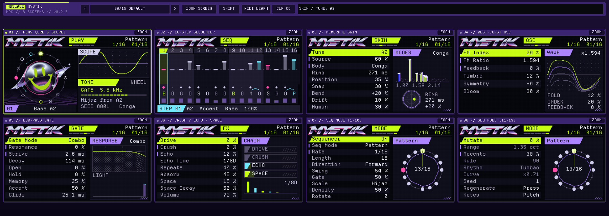

# hdslave Mystik — macOS (and Windows) Desktop CLAP Plug-in

Separate desktop CLAP build of **hdslave Mystik** for **FL Studio** (2024+) and any other CLAP host on macOS (Apple Silicon / Intel) and Windows (x64).



- **Multi-Screen MPC Dashboard:** displays all of hdslave Mystik's native MPC screens simultaneously on one resizable Retina/HiDPI panel (with the hardware `K1`–`K3` footer panels removed) and direct mouse, trackpad, and touch control over every parameter, plot, sequencer, and pad.
- **Standalone from the MPC Sample build:** this directory is completely separate from the MPC Sample build in the repository root (`../src`, `../build.sh`). GitHub releases remain MPC Sample-only for now while the desktop builds are being finalized.

## Build & Install (macOS)

Requires Xcode Command Line Tools and CMake 3.20+ (Ninja optional):

```bash
cd mac-clap
./build-macos.sh
./install-macos.sh
```

`build-macos.sh` runs two tests after the build: `tests/host_test.cpp` (a strict CLAP host loading the bundle: parameters, state, every preset, the panel) and `tests/hold_test.cpp` (the inner plug-in as the bundle runs it: Hold following the key that struck the drum last, no older strike's gate end cutting a step's Hold, a gate end never lost from a full queue, Stop taking the sequence's queued hits, a block's first-frame events in the MPC build's order: settings, transport, notes, then the page's presses; a pre-roll's steps with their gate ends; a late wrap's step as told on time, Turing and Brownian moving once; a step dropping the audition's roll).

`install-macos.sh` builds, ad-hoc signs, tests, and installs `Mystik.clap` to `/Library/Audio/Plug-Ins/CLAP/` (pass `--user` to install to `~/Library/Audio/Plug-Ins/CLAP/`). Quit and reopen FL Studio after reinstalling so macOS reloads the updated bundle.

## Build (Windows x64)

```powershell
cd mac-clap
.\build-windows.ps1
```

Copy `build\windows\clap\Release\Mystik.clap` to `C:\Program Files\Common Files\CLAP\`.
